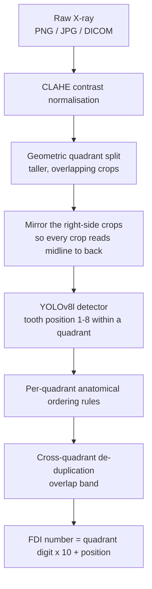

# Tooth Detection & FDI Numbering on Panoramic X-rays
 
Detects every visible tooth in a panoramic dental X-ray (OPG) and assigns each one its **FDI number** (11-18, 21-28, 31-38, 41-48). Built on YOLOv8 and trained on the DENTEX dataset.
 
> **Research use only.** This is not a medical device and must not be used for diagnosis or treatment decisions.
 
---
 
## How it works
 
This is a computer vision problem (localisation + classification), so it uses an object detector, not an LLM.
 

 
**Key design choices**
 
- **One trained model only.** Quadrant splitting is plain geometry, not a second network. The detector only predicts position 1-8 inside a quadrant; the FDI number is computed afterwards.
- **Empirically detected orientation.** `prepare_dentex_dataset.py` works out which image corner holds each FDI quadrant, and which quadrants need mirroring, from the real annotation coordinates. It saves the result to `quadrant_layout.json`, and inference loads the same file, so training and inference cannot drift apart.
- **Overlapping vertical crops.** A flat image-height / 2 split clipped upper-tooth crowns in 96.3% of the 569 training images checked (the true bite line ranged from 0.367 to 0.714 of image height, mean 0.537). Crops now extend `VERTICAL_OVERLAP = 0.23` past the midline in both directions. Duplicate detections in the overlap band are resolved by keeping the higher-confidence one.
- **Train / inference parity.** Contrast normalisation, cropping and flipping all live in `preprocessing.py` and are used by both data prep and inference.
- **Anatomical rules.** Within a quadrant, tooth positions must increase monotonically outward from the midline. `rules.py` drops duplicate classes and out-of-order detections.
---
 
## Repository layout
 
| File | Purpose |
|---|---|
| `preprocessing.py` | Shared logic: CLAHE, DICOM windowing, quadrant crop/flip/unflip, `VERTICAL_OVERLAP` |
| `prepare_dentex_dataset.py` | DENTEX annotations -> quadrant-cropped, canonicalised YOLO dataset + `quadrant_layout.json` |
| `rules.py` | Per-quadrant ordering correction and cross-quadrant de-duplication |
| `train.py` | YOLOv8l training |
| `infer_raw.py` | Predict FDI numbers on a raw image |
| `visualize_detections.py` | Draw predictions on one image |
| `batch_visualize.py` | Run and draw predictions on a whole folder, with a summary table |
| `visualize_ground_truth.py` | Draw DENTEX ground-truth boxes for comparison |
| `check_occlusal_split.py` | Measures how often a flat midline split clips teeth (the analysis behind `VERTICAL_OVERLAP`) |
| `plot_training.py` | Draws the training-curve charts (light and dark PNG) from a YOLO `results.csv` |
| `docs/` | Chart images used in this README, plus the baseline run's `results.csv` |
| `split_train_val.py` | 90/10 train/val split (seed 42) of the 634 labelled images |
| `data.yaml` | Class definitions (`position_1` ... `position_8`) |
 
---
 
## Dataset
 
[DENTEX](https://huggingface.co/datasets/ibrahimhamamci/DENTEX) (MICCAI 2023), `quadrant_enumeration` subset: 634 panoramic X-rays with quadrant and tooth-enumeration labels.
 
- **License: CC-BY-NC-SA 4.0** (non-commercial, share-alike). Check this before any commercial use.
- DENTEX does not ship an official split for this subset, so `split_train_val.py` creates a 90/10 split: 571 train / 63 val.
- Annotations use `category_id_1` (quadrant) and `category_id_2` (position in quadrant), both 0-indexed. The prep script detects the indexing automatically.
- Boxes are tall and narrow because DENTEX derives them from tight per-tooth outlines. The model reproduces that convention.
### Downloading only what you need
 
`training_data.zip` is 10.9 GB. To avoid downloading all of it, fetch just the subset with `remotezip`:
 
```bash
pip install remotezip
```
 
Extract only `training_data/quadrant_enumeration/` from
`https://huggingface.co/datasets/ibrahimhamamci/DENTEX/resolve/main/DENTEX/training_data.zip`.
 
Range-request extraction can silently leave missing or truncated files. Verify every PNG fully decodes (`PIL.Image.open(p).load()`) and re-fetch any that fail.
 
---
 
## Quick start
 
```bash
pip install ultralytics opencv-python pillow numpy pydicom
```
 
**1. Split the data**
 
```bash
python3 split_train_val.py
```
 
**2. Build the quadrant-cropped YOLO dataset**
 
```bash
python3 prepare_dentex_dataset.py \
  --dataset-root ./dentex_split \
  --out-root ./dentex_yolo_quadrants \
  --train-ann train/annotations.json \
  --val-ann val/annotations.json
```
 
Check the printed layout lines and the `boxes skipped` counts. Re-run this whenever `preprocessing.py` changes.
 
**3. Train**
 
```bash
python3 train.py
```
 
Notes:
- `fliplr=0.0` on purpose. Crops are already orientation-canonicalised, and a random flip would break the midline -> back ordering.
- `batch=-1` (autobatch) because YOLOv8l can run out of memory on smaller GPUs. Set a fixed value (e.g. 4 or 8) if needed.
- If you change crop geometry or preprocessing, **retrain from scratch**. An old checkpoint does not match new crops.
**4. Predict on a raw image**
 
```bash
python3 infer_raw.py path/to/xray.jpg \
  --model runs/tooth_detect/quadrant_yolov8l/weights/best.pt \
  --layout dentex_yolo_quadrants/quadrant_layout.json
```
 
Prints one line per detected tooth: FDI number, confidence, and box in full-image coordinates. DICOM (`.dcm`) input is supported.
 
**5. Visualise**
 
```bash
python3 visualize_detections.py path/to/xray.jpg --model <best.pt>
 
python3 batch_visualize.py path/to/folder --model <best.pt>
```
 
Green boxes are confidence >= 0.6, orange are lower. `--box-padding 0.15` widens the drawn boxes for readability only. Use the unpadded boxes from `infer_raw.py` for anything downstream.
 
**6. Plot the training curves**
 
```bash
pip install matplotlib
python3 plot_training.py \
  --csv runs/tooth_detect/quadrant_yolov8l/results.csv \
  --out-dir docs \
  --subtitle "YOLOv8l, 571 train / 63 val images"
```
 
Writes `docs/training_curves_light.png` and `docs/training_curves_dark.png`. Re-run it after every retrain so the charts below match your current weights.
 
---
 
## Results
 
Baseline run (YOLOv8l, **before** the overlapping-crop change), best epoch (16 of 36, early-stopped with `patience=20`) on the 63-image validation split:
 
| mAP50 | mAP50-95 |
|---|---|
| 0.943 | 0.545 |
 
<picture>
  <source media="(prefers-color-scheme: dark)" srcset="docs/training_curves_dark.png">
  
</picture>
Training loss kept falling after epoch 16 while validation loss started rising, which is overfitting. Ultralytics keeps the epoch-16 weights as `best.pt`, so that is the checkpoint to use. Training stopped itself at epoch 36 (`patience=20`).
 
On real clinical images from a different source, numbering order was anatomically correct across all four quadrants, but the **upper arch was noticeably weaker** than the lower arch (missed or low-confidence teeth). This traced back to the flat midline split clipping upper crowns, which is what the overlapping-crop change addresses.
 
> **TODO:** retrain with the overlapping crops, then update this table and re-run the same real-world images for a before/after comparison.
 
---
 
## Demo app: end-to-end OPG analysis
 
A demo app chains two models on a single panoramic X-ray (OPG):
 
| Model | File | Job |
|---|---|---|
| Model 1 | `fdi_numbering.pt` (87.6 MB) | Detects and numbers the teeth (FDI) |
| Model 2 | `rct_quality.pt` (210.5 MB) | Runs on each tooth crop to assess root canal treatment (RCT). Backend: Ultralytics YOLO OBB |
 
Default settings: Model 1 confidence 0.25, running on CPU.
 
What the app shows after you upload an OPG:
 
- **Risk heatmap** overlaid on the X-ray.
- **Per-tooth report** with the FDI number, detection confidence and RCT status (for example `RCT_Present`, `No_RCT`).
- **Dataset dashboard** with images processed, teeth detected, RCT prevalence and periapical lesion prevalence.
- **CSV export** via the "Download combined report (CSV)" button.
Smoke test: one image (`download (4).png`) ran through the full pipeline without errors. It gave 14 detected teeth, RCT prevalence of 35.7% (5 of 14) and periapical lesion prevalence of 0%. This confirms the pipeline runs end to end. It is a single image, so it says nothing about accuracy.
 
> The model weights (`*.pt`) are large. Do not commit them to the repo. Host them separately (for example on Hugging Face or GitHub Releases) and link them here.
 
---
 
## Known limitations
 
- Trained on DENTEX only (three institutions). Expect a drop on images from unseen X-ray machines.
- Only 571 training images, so results on unusual dentition (heavy restorations, implants, missing teeth, child dentition) may vary.
- The geometric split assumes a roughly centred, upright panoramic image. Strongly rotated or off-centre images may need a learned midline detector.
- Teeth in the overlap band depend on the de-duplication step. Always review low-confidence detections.
---
 
## Citation
 
If you use this work, please also cite the DENTEX dataset (Hamamci et al., MICCAI 2023) and follow its license terms.
 
## License
 
Code: *add your license here (e.g. MIT).*
Data: DENTEX is CC-BY-NC-SA 4.0 and is **not** redistributed in this repository.
 
Claude finished the response
